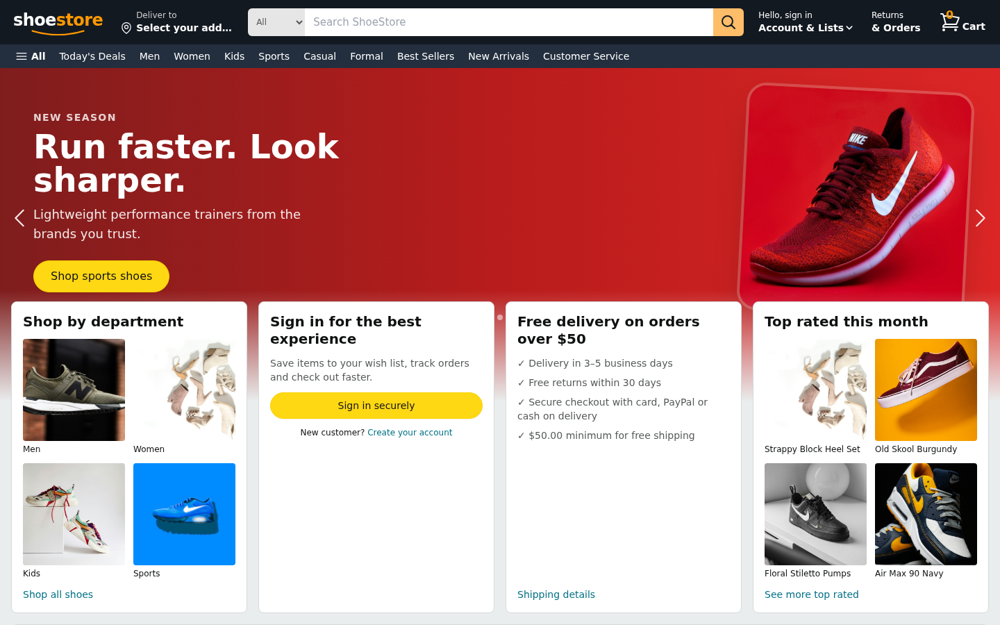
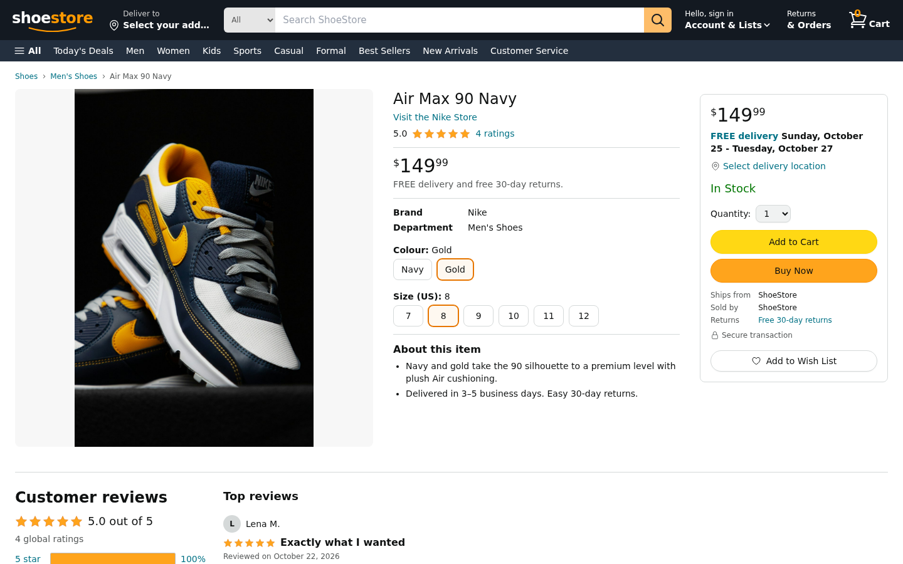
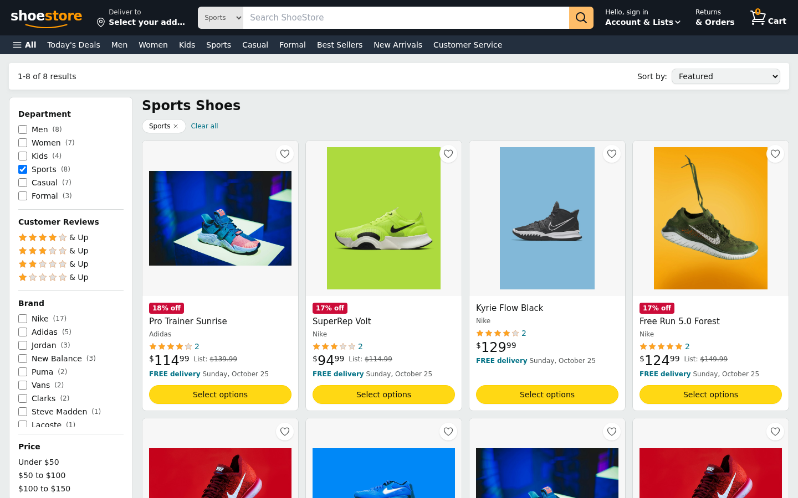
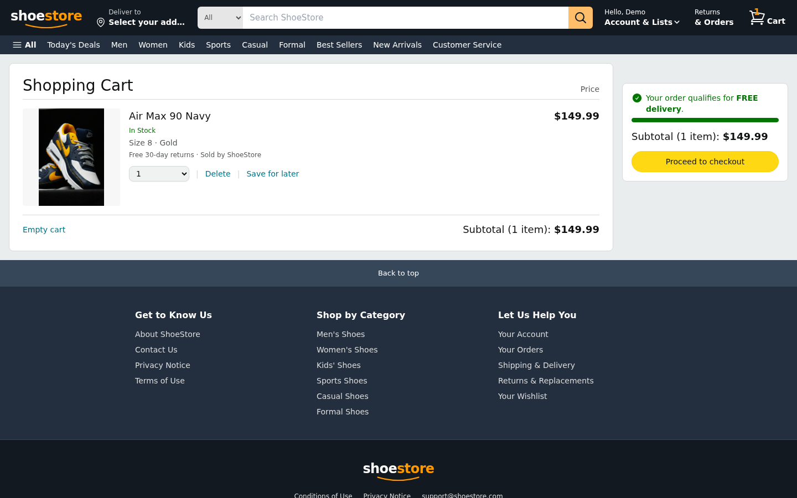
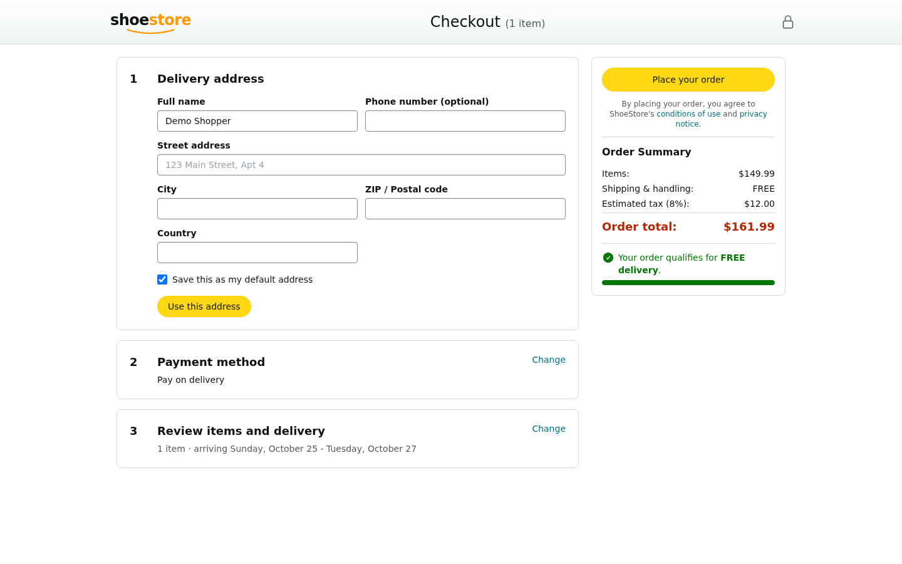
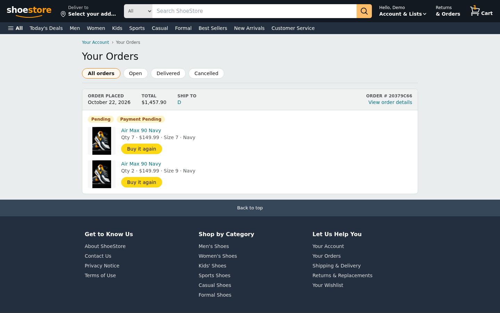

# ShoeStore: Full-Stack E-Commerce

A complete, Amazon-style shoe store built with the MERN stack: product discovery, reviews, cart, wish list, multi-step checkout, order tracking, payments and an admin dashboard. The storefront is fully responsive and server-rendered.

| Home | Product details |
| --- | --- |
|  |  |

| Search & filters | Cart |
| --- | --- |
|  |  |

| Checkout | Orders | Mobile |
| --- | --- | --- |
|  |  |  |

## Features

**Storefront**
- Header with category search, live suggestions, account menu, cart badge and department bar
- Hero carousel, deal and best-seller rows, shop-by-category tiles
- Search results with department, brand, rating, price and availability filters, sorting and pagination (filters live in the URL, so every view is shareable)
- Product page with zoom gallery, size and colour selection, buy box, stock messaging, "Buy Now", rating histogram, verified reviews and related products
- Persistent cart with per-size/colour lines, stock-aware quantities, free-shipping progress and save for later
- Wish list, order history, order tracking, order cancellation
- Three-step checkout (address, payment, review) with Cash on Delivery, Stripe or PayPal
- Account area: profile, default address, password change, account deletion
- Sign in, sign up with live password rules, password reset by email

**Admin** (`/admin`)
- Order management with status updates and revenue summary
- Product create, edit and delete

**Backend**
- JWT auth, bcrypt hashing, login lockout, rate limiting, Helmet, CORS allow-list, request validation
- Server-calculated pricing (items, shipping, 8% tax) so clients can't tamper with totals
- Atomic stock reservation with rollback, so concurrent checkouts can't oversell
- Stripe Checkout (with webhook) and PayPal redirect flows tied to real orders

## Tech stack

| Layer | Stack |
| --- | --- |
| Frontend | React 19, React Router 7, Tailwind CSS, Headless UI, Vite 7 with SSR |
| Backend | Node.js, Express 5, Mongoose |
| Database | MongoDB |
| Payments | Stripe, PayPal |

## Getting started

Requires Node 20+ and MongoDB. The short version:

```bash
# 1. API
cd shoe-ecommerce-backend
cp .env.example .env        # set MONGODB_URI and JWT_SECRET
npm install
npm run seed                # 37 products + demo accounts
npm run dev                 # http://localhost:5000

# 2. Storefront (new terminal)
cd shoe-ecommerce-frontend
npm install
npm run dev                 # http://localhost:5173
```

Sign in with `demo@shoestore.com` / `Demo@12345` (customer) or `admin@shoestore.com` / `Admin@12345` (admin).

For MongoDB options, every environment variable, Stripe/PayPal/email setup, production builds and troubleshooting, see **[docs/running-the-project.md](docs/running-the-project.md)**.

## API overview

| Area | Endpoints |
| --- | --- |
| Auth | `POST /api/auth/register`, `login`, `forgot-password`; `PUT /api/auth/reset/:token`, `change-password`, `profile`; `GET /api/auth/profile`; `DELETE /api/auth/delete-account` |
| Products | `GET /api/products` (search, category, brand, min, max, rating, inStock, deals, sort, page, limit), `/meta`, `/:id`, `/:id/related`; `POST /:id/reviews`; admin `POST`, `PUT`, `DELETE` |
| Cart | `GET`, `POST` (productId, quantity, size, color), `DELETE /api/cart`; `PATCH`, `DELETE /api/cart/:itemId` |
| Wish list | `GET`, `POST /api/wishlist`; `DELETE /api/wishlist/:productId` |
| Orders | `POST /api/orders`, `GET /my`, `GET /:id`, `PATCH /:id/cancel`; admin `GET /api/orders`, `PATCH /:id/status` |
| Payments | `POST /api/payments/stripe/session`, `stripe/confirm`, `stripe/webhook`, `paypal/create`, `paypal/capture` |

## Project structure

```
shoe-ecommerce-backend/    Express API (controllers, models, middleware, scripts/seed.js)
shoe-ecommerce-frontend/   React app (pages, components, context, hooks, SSR server)
docs/                      Run guide, design notes and screenshots
```
